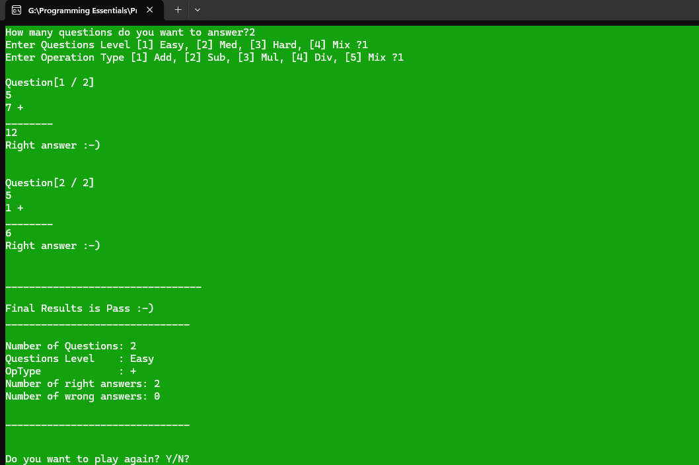

# Math Quiz Game

A console-based Math Quiz Game developed in C++.

This was my second C++ project, focused on practicing functions, procedural programming, and organizing a program into reusable components.

The application generates random arithmetic questions based on the selected difficulty level and operation type. Players answer the questions and receive immediate feedback, followed by a final quiz result.

## Features

- Customizable number of questions (1–10)
- Three difficulty levels: Easy, Medium, and Hard
- Mixed difficulty mode
- Four arithmetic operations: Addition, Subtraction, Multiplication, and Division
- Mixed operation mode
- Randomly generated questions and operands
- Immediate feedback for correct and incorrect answers
- Console color changes based on answer correctness
- Final results showing the number of correct and incorrect answers
- Pass/Fail evaluation
- Option to replay the quiz

## Screenshots



## Technologies

- **C++**
- Standard Library
  - `iostream`
  - `cstdlib`
  - `ctime`

## Concepts Demonstrated

This project was built to practice fundamental and intermediate C++ programming concepts, including:

- Enumerations (`enum`)
- Structures (`struct`)
- Functions and functional decomposition
- Arrays
- Conditional statements
- `switch` statements
- Loops
- Type casting
- Random number generation
- References
- User input and output
- Basic program organization

## How It Works

1. The player chooses the number of questions (between 1 and 10).
2. The player selects a difficulty level:
   - `1` — Easy
   - `2` — Medium
   - `3` — Hard
   - `4` — Mixed
3. The player selects an arithmetic operation:
   - `1` — Addition
   - `2` — Subtraction
   - `3` — Multiplication
   - `4` — Division
   - `5` — Mixed
4. The program generates random questions according to the selected settings.
5. The player answers each question and receives immediate feedback.
6. The program tracks correct and incorrect answers.
7. At the end, the final results are displayed along with a Pass/Fail evaluation.
8. The player can choose to start another quiz.

## How to Run

### Requirements

- Windows operating system
- Visual Studio with C++ development tools installed

### Using Visual Studio

1. Clone the repository:

```bash
git clone https://github.com/HeshamSallem510/Math-Quiz-Game-CPP.git
```

2. Open the solution in Visual Studio.
3. Build the solution.
4. Run the application.

> The application uses Windows-specific console commands such as `system("cls")` and `system("color")`, so the current implementation is intended for Windows.

## Example

```text
How many questions do you want to answer? 3

Enter Questions Level [1] Easy, [2] Med, [3] Hard, [4] Mix ? 1

Enter Operation Type [1] Add, [2] Sub, [3] Mul, [4] Div, [5] Mix ? 1

Question[1 / 3]
5
3 +
________
8

Right answer :-)

...

Final Results is Pass :-)

Number of Questions: 3
Questions Level    : Easy
OpType             : +
Number of right answers: 3
Number of wrong answers: 0
```

## Author

**Hesham Elsayed**